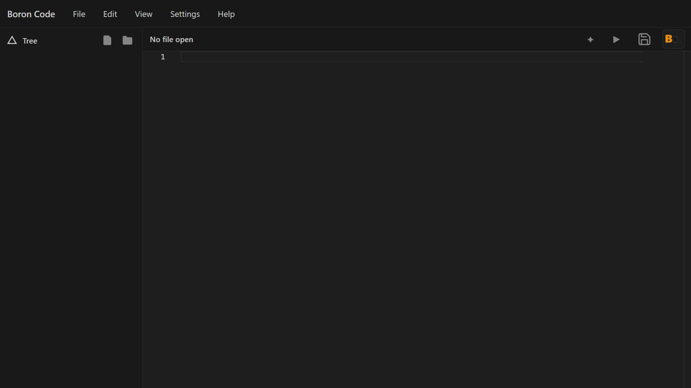

# BORON CODE 

Light-weight, low-storage Code Editor with Monaco Editor, a native OS terminal launcher (Windows Terminal, Terminal.app, or x-terminal-emulator) rooted at the project folder, industry standard 20+ shortcuts and File Tree, custom UI, and custom syntax highlighting for each coding language. With the total file size of <20 MBs and 33 MBs of total self-cleaning runtime environment, and no electron overhead, Boron Code is made for devices with low storage.

     
 
## WHAT'S NEW !!
  

✅ Implemented a native Chat Window to use AI locally or via an API Provider

✅ Implemented Monaco Editor as the IDE's formatter and code canvas, getting rid of the manual breakage-prone overhead 

✅ Multi-CDN Fallback Loader - dynamically cycles through three CDNs (jsdelivr, unpkg, cdnjs) if Monaco Editor fails to load.

## Preview - Dashboard 

> ATTENTION: This is a brief introduction to this project, meant for onboarding and getting started. To see examples, details, project explainations and implementation, refer to [Details.](workflowandcontext.md)


## Trademark and Copyright infringement prevention

This is not in any way a tutorial, or a copy of any other 'editor', 'brand' or 'product'. Any similarities are purely coincidental. The author will NOT be held responsible for any forks or copies of this software which may immitate any of the above mentioned items.


## FEATURES

1. Monaco Editor as the IDE's code canvas, syntax highlighter and formatter

1. Sidebar and toolbar similar to popular IDEs and code editors

1. Very small size on drive and minimal RAM footprint

1. Custom indentation for each Language & Indentation preservation


## HIGHLIGHTS

1. A custom native window for chatting with AI, whether with a Local Model or via an API

1. Can be run on all devices, from old legacy devices to modern powerhorses

1. Can be used on Localhost, natively as a Webapp, or a full-pledged windows app


## SHORTCUTS


| Shortcut | Action | Implementation |
| --- | --- | --- |
| `Ctrl + N` | New file in root/target directory | Triggers sidebar button or fallback prompt |
| `Ctrl + Shift + N` | New folder in root/target directory | Triggers the new-folder action |
| ``Ctrl + ` `` | Open native OS terminal in the working directory (temp if nothing is open) | Calls `POST /launch-native-terminal` |
| `Ctrl + S` | Save active file | Calls `POST /save-file` |
| `Ctrl + Z` | Undo inside editor | Executes `document.execCommand('undo')` |
| `Ctrl + Y` | Redo inside editor | Executes `document.execCommand('redo')` |
| `Ctrl + X` | Cut selected text | Executes `document.execCommand('cut')` |
| `Ctrl + C` | Copy selected text | Executes `document.execCommand('copy')` |
| `Ctrl + V` | Paste copied text | Standard native canvas paste |
| `Ctrl + K` -> `Ctrl + O` | Open directory picker | Triggers folder input picker |
| `Ctrl + O` | Open single file picker | Triggers file input picker |


## DEPENDENCIES - (skip if downloading application from [Github Releases](https://github.com/akashdeepmaity4/boroncode/releases/latest))


- Python 3.10+ (3.14 recommended)

- Flask (Non-Negotiable)

- Pywebview (For PWA)

- Pyinstaller (For Windows Application)

- Bash (only needed to run `.sh` files through Run File; the native terminal does not depend on it)


## INSTALL DEPENDENCIES

```

pip install -r requirements.txt

```


## HOW TO USE


### 1. Windows Application (Recommended for all windows users)

> Note: x64 CPU Architecture is required for this build. x86 may work due to Backwards compatibility but with bugs. 

1. Click to download the latest release from [BoronCode](https://github.com/akashdeepmaity4/BoronCode/releases/latest/download/BoronCode.exe)


### 2. Progressive Webapp (Recommended for Linux / Mac users)

1. Download the codebase.

```bash
cd path/to/your/root
git clone https://github.com/akashdeepmaity4/boroncode.git
```

2. Run Bash or Cmd in root directory of the codebase.

3. install the dependencies

4. run 'launcher.py' to launch the PWA (entire codebase should be downloaded to prevent any errors)

> NOTE : Standalone for Linux / Mac coming soon ...

```

cd path/to/root/directory

python launcher.py

```
