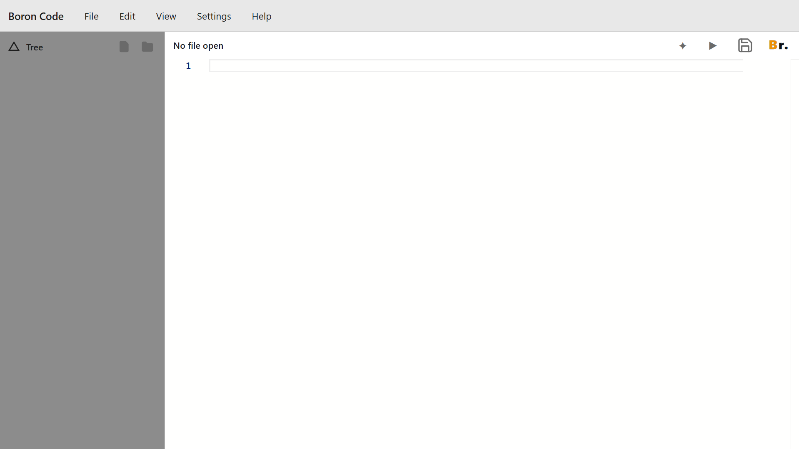
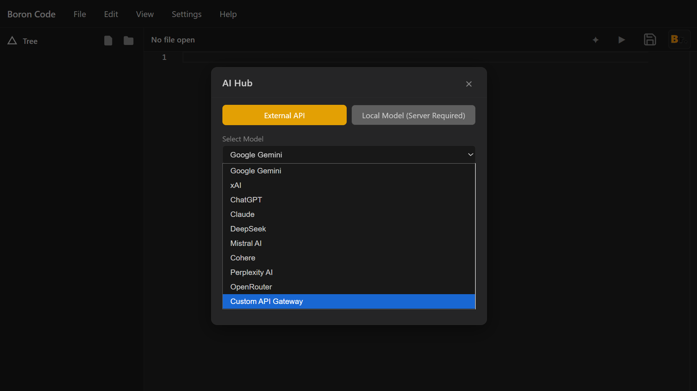

# Boron Code: Workflow and Technical Context

This document is the working source of truth for the Boron Code project. It describes the runtime architecture, operational flow, and engineering assumptions behind the app rather than a marketing overview. Last reviewed against the current checkout on 2026-11-28 (`HEAD` = `7a82aba`, "stable"); updated the same day for the native terminal change.

## Screenshots - Homepage, while in use, and AI Integration

### Homepage - Default

### Homepage - Light Mode

### While Working - Editing Code

### AI Integration - Native Support for API as well as Local Models

### AI - Multi-Provider Support

---

## 1. Project purpose

Boron Code is a lightweight local IDE/workspace environment that combines:

- workspace browsing and file management
- code editing with Monaco editor and an offline editor fallback
- code execution for local scripts
- shell access via the operating system terminal
- AI assistant integration through either cloud providers or custom/local gateways
- safe path handling for files and model locations

The application is a Flask backend with a browser-based frontend and an optional pywebview desktop shell.

---

## 2. Runtime structure

### Primary backend

- `app/app.py` contains the Flask app, every HTTP route, path validation helpers, AI provider adapters, native terminal launch logic, and file execution logic.
- `app/__init__.py` is empty.

### UI layer

- `templates/index.html` defines the menu bar, sidebar/file-tree mount, editor header, editor container, AI Hub overlay mount, and AI chat popup. It includes `templates/apiform.html`, loads `static/js/main.js` and `static/css/style.css`, and contains the inline Monaco CDN loader.
- `templates/apiform.html` is the AI Hub fragment: external provider selection, gateway URL, model name, API key, local model path/gateway, model search, and setup guide.
- `static/js/main.js` owns client state and event wiring: editor initialization, file/folder pickers, indented tree rendering, menus, shortcuts, themes/settings, run/save actions, a thin terminal-launch bridge that reports active file/folder paths, AI setup, and chat.
- `static/js/fallback-editor.js` exports `createFallbackEditor()`. It dynamically loads the bundled CodeJar + Prism assets and maps Monaco language IDs to Prism languages; if that setup fails it returns a plain `contenteditable` text editor with the same adapter API.
- `static/vendor/codejar/` and `static/vendor/prism/` are bundled offline editor assets (CodeJar, Prism bundle, and `monaco-prism-map.json`).
- `static/css/style.css` defines the IDE layout, menus, overlays, themes, syntax colors, and responsive presentation.

### Launch wrapper

- `launcher.py` starts the Flask app inside a pywebview window. It exposes `DesktopFileApi` for native file/folder dialogs and authorized-path read/write/delete operations; the folder dialog returns both a display name and the selected root path so the terminal can open there. It also handles `--boron-run-python <script>` for frozen-build Python execution fallback.

### Supporting files

- `requirements.txt` declares Flask, pywebview, and PyInstaller.
- `readme.md` is the user-facing install/use/shortcut overview; `FAQs.md` is the developer FAQ; `workflowandcontext.md` is this architecture record; `LICENSE` is MIT; `.gitignore` excludes environments, binaries, caches, and local artifacts.
- `assets/` holds the five README/workflow screenshots.

There is no `formatting.py`, `tests/` directory, or `PowerShell/` maintenance script in the tracked checkout. `.venv/`, `__pycache__/`, and ignored local scratch files may exist on disk but are not application source.

---

## 3. Startup and editor pipeline

- Browser mode: `python app/app.py` serves on port 5000 with `debug=False`. Desktop mode: `python launcher.py` starts Flask through pywebview.
- `WORKSPACE_ROOT` is the repository root; Flask uses the root `templates/` and `static/` directories.
- `templates/index.html` loads Monaco `0.45.0` loader scripts from jsDelivr, unpkg, and cdnjs in order, with a 12-second timeout per CDN. It sets `window.__monacoVsPath`, `window.__monacoLoadState`, and `window.__fallbackAssetUrls`, and dispatches `monaco-loader-ready` or `monaco-loader-failed`.
- On `DOMContentLoaded`, `main.js` wires the UI, then `initMonaco()` starts Monaco using `require.config({ paths: { vs: ... }, waitSeconds: 12 })`. If `vs/editor/editor.main` fails, it retries the other CDN paths.
- If all Monaco paths fail, `activateFallbackEditor()` imports `static/js/fallback-editor.js`, which loads bundled CodeJar + Prism and the language map. If that also fails, it falls back to a plain text editor. Status messages distinguish "offline syntax editor" from "plain text editing".
- Both editors are normalized behind an adapter with `getValue`, `setValue`, `setLanguage`, `setOptions`, `focus`, `selectAll`, and `dispose`. Client state (`editorTextCache`, dirty flag, debounced auto-save) is editor-agnostic.
- Themes are `theme-light`, `theme-dark` (default), and `theme-amoled`. Dark uses the darker palette that was previously offered as a separate option, so it is slightly darker than before.
- `applyMonacoSyntaxTheme()` builds a session Monaco theme on every theme change: token colors come from the active theme's `--syntax-color-*` variables, and editor chrome (`editor.background`, gutter, line numbers, line highlight, selection, cursor, indent guides, widgets, and suggestions) comes from the active theme's `--bg-*`, `--text-*`, `--border-color`, `--menu-*`, and `--editor-selection*` variables. Settings allow per-token syntax colors (applied on `body` so they still override theme defaults), font size, bold, italic, and line-number toggling. Markdown files get a preview toggle.

---

## 4. File and workspace workflow

### Host-specific pickers

- In the browser, the app prefers the File System Access API (`showOpenFilePicker`, `showDirectoryPicker`) and otherwise uses the hidden `filePicker` / `folderPicker` inputs.
- In pywebview, native dialogs return paths that are added to a lock-protected authorized set in `DesktopFileApi`; folder enumeration skips `.git` directories. Only authorized paths can be read, written, or deleted through that bridge.

### Flask workspace routes

- `GET /workspace-root` returns the workspace root.
- `GET /list-workspace` lists root entries one level deep and skips names starting with `.git`.
- `POST /read-file` reads UTF-8 workspace files.
- `POST /save-file` writes UTF-8 text and can remove a previous file named in `old_path` (Save As / move workflow).
- `POST /delete-file` removes a workspace file.
- `POST /create-folder` creates a child folder under the workspace root or a requested target directory.
- Path containment and `.git` checks are applied before disk access; errors are returned as JSON with explicit status codes.

### Client-side operations

New file, new folder, open file/folder, save, Save As, Save Copy As, delete (for move workflows), auto-save, and collapsible tree rendering all live in `static/js/main.js`. Browser-backed workspace operations go through Flask; externally selected desktop files go through the pywebview bridge.

### Keyboard bindings

| Shortcut | Action |
| --- | --- |
| `Ctrl + N` | New file |
| `Ctrl + Shift + N` | New folder |
| `Ctrl + K` → `Ctrl + O` | Open folder picker |
| `Ctrl + O` | Open file picker |
| `Ctrl + S` / `Ctrl + Shift + S` | Save / Save As |
| `Alt + Shift + S` | Save copy as |
| `Ctrl + Z` / `Ctrl + Y` | Undo / redo |
| `Ctrl + X` / `Ctrl + C` / `Ctrl + V` / `Ctrl + A` | Clipboard and select-all actions |
| `Ctrl + Shift + V` | Markdown preview (when applicable) |
| ``Ctrl + ` `` | Launch the native OS terminal in the opened project root, then the active file's folder, or temp if nothing is open |
| `Ctrl + P` | Print window |

The File menu also exposes Close Window (`Alt + F4`) and Exit (`Ctrl + Q`) items; those are menu actions, not global keydown handlers in `main.js`.

---

## 5. Code execution and terminal flow

- `POST /run-file` allows only `.py`, `.js`, and `.sh`, resolves the path with `resolve_runnable_path()` (workspace-relative or an absolute path the user explicitly opened), runs with `subprocess.run(..., shell=False)`, captures stdout/stderr, and times out after 15 seconds.
- `find_interpreter()` searches `PATH` first, then common install locations: Python (`python`/`python3`/`py` plus standard, Anaconda/Miniconda/Miniforge/Mambaforge, and Homebrew paths), JavaScript (`node`/`nodejs` plus Node/nvm paths), and shell (`bash` plus Git Bash paths). Windows Store `WindowsApps` stubs are skipped.
- Python runs with the discovered user interpreter. If none is found, a frozen PyInstaller build re-launches the bundled runtime via `launcher.py --boron-run-python <script>`; a source build falls back to `sys.executable`. Both fallbacks return a user-visible warning.
- Non-Python runtimes have no bundled fallback. If none is found, the route returns `status: interpreter-missing` with `no <language> interpreter found on drive`, which the frontend shows through the existing `showStatus(..., 'warn')` message box.
- `POST /launch-native-terminal` is the only terminal route. The frontend sends only its current state (`activePath` and `folderPath`); Python's `resolve_terminal_cwd()` decides the directory. No shell command text is accepted from the client.
- If `folderPath` points at an existing directory, that opened project root is used first. `activePath` is the next candidate: a file uses its parent directory and a directory uses that directory. Missing, invalid, or `.git` paths are skipped. If neither is usable, Python falls back to `tempfile.gettempdir()`.
- Windows uses `wt.exe --startingDirectory <cwd>`, macOS uses `open -a Terminal <cwd>`, and Linux uses `x-terminal-emulator` with `cwd=<resolved directory>` and `shell=False`.
- The old `/open-terminal` route, Git Bash/CMD resolution chain, and clipboard/paste command preparation have been removed. The JSON reply includes the resolved `path` and a `usedTemp` flag.

---

## 6. AI workflow

- The AI Hub (`templates/apiform.html`) exposes external providers (Gemini, Grok, ChatGPT, Claude, DeepSeek, Mistral, Cohere, Perplexity, OpenRouter, Custom API Gateway) and a local-model section with gateway URL, model path, browse, model search ("Enlighten Me"), and a setup guide.
- `POST /api/verify-external-api` validates provider/key or custom gateway requirements and performs a live test request.
- `POST /api/verify-local-model` validates the supplied model path or gateway URL shape and returns a model name; it does **not** probe a gateway.
- `POST /api/search-local-models` filters submitted file paths and can scan supplied folders for `.gguf`, `.bin`, `.safetensors`, `.onnx`, `.pth`, and `.pt` files.
- `POST /api/ai-chat` routes to `call_external_ai_api()` for custom gateways or when an API key is present (unless the provider label contains `local`), otherwise to `call_local_ai_model()`. The current editor contents are sent as `codeContext`.
- `call_local_ai_model()` probes a supplied gateway plus common localhost ports (11434, 1234, 8080, 8081, 8000, 3000) using `/api/generate`, `/v1/chat/completions`, and `/chat/completions`. If no server answers but a model file exists, it returns a structured "Loaded" notice; otherwise it returns a structured connection error instead of crashing.
- HTTP failures are converted to JSON errors; the chat popup renders replies or error messages in the floating AI window.

---

## 7. Security model

The backend is intentionally defensive.

### Path restrictions

- `resolve_workspace_path()` prevents traversal outside the workspace root for relative paths.
- `resolve_runnable_path()` additionally accepts absolute paths for files the user explicitly opened, but only after `is_safe_relative_path()` rejects traversal and shell metacharacters.
- `is_git_restricted()` blocks any path that touches a `.git` directory.
- The pywebview bridge only operates on paths explicitly authorized through its dialogs.

### Input sanitization

- `sanitize_str()` trims and HTML-escapes user-controlled strings before they are used in routes or replies. Path, URL, and API-key helpers additionally strip NUL and CR/LF characters.
- Provider names are normalized and constrained to an allowlist before outbound API calls; unknown or custom-like labels collapse to the `custom` route.
- Gateway URLs are normalized before requests are built.

### Execution restrictions

- `run-file` uses an extension allowlist, `shell=False`, and argument lists. No shell interpretation is applied to user file paths.
- The terminal launcher uses a fixed per-platform argument list, the Python-resolved project root (or file folder fallback), and `shell=False`; it accepts no user-supplied command text. Path values from the client are treated as location hints only.

---

## 8. Gateway and provider normalization

### URL normalization rules

- Missing scheme is auto-filled with `http://`.
- Trailing slashes are stripped.
- `/chat/completions` and `/api/generate` suffixes are stripped back to a base gateway root; a base ending in `/v1` is preserved as-is.
- The final OpenAI-compatible endpoint is built as `/v1/chat/completions` for a base URL, or `/chat/completions` when the base already ends in `/v1`. Already-complete chat-completions URLs are left intact.

This supports gateway shapes such as `localhost:1234/v1/`, `https://example.com/base/`, and `https://api.example.com/chat/completions`.

### Provider routing logic

- `custom`, `gateway`, and unrecognized provider labels are treated as a single custom route and require a gateway URL.
- Non-custom providers require a valid API key; verification rejects keys shorter than five characters.
- Known providers use vendor-specific endpoints and payload/response extraction, including Gemini model fallback, Anthropic messages, Cohere chat, and OpenAI-compatible providers.

---

## 9. Testing and verification status

There is no `tests/` directory or automated pytest suite in this checkout. `FAQs.md` item 10 still refers to running `pytest -q`; that instruction is stale for the current tree.

Before relying on changes to gateway, path, or execution handling, verify behavior manually or with temporary mocked-network checks:

1. Start with `python app/app.py` and load `http://localhost:5000/`.
2. Open a workspace file, edit it, save it, and confirm `/read-file` returns the saved content.
3. Confirm Monaco loads, then simulate CDN failure to confirm the CodeJar/Prism fallback and plain-text fallback.
4. Verify custom gateway normalization with `localhost:1234/v1`, a bare host, and a full `/chat/completions` URL.
5. Verify `verify-external-api` rejects missing keys for known providers but accepts a gateway-only custom provider.
6. Run a small `.py` file and confirm output plus the 15-second timeout path.
7. Confirm ``Ctrl + ` `` calls only `/launch-native-terminal`; with an open folder and a nested active file, verify `subprocess.Popen` receives the folder root, and with no selection, verify it receives the system temp directory.

The historical regression pattern was to validate real behavior with mocked network calls rather than mock-only assertions.

---

## 10. Operational notes for contributors

When changing backend logic:

- keep provider names normalized before routing
- preserve workspace containment checks
- normalize gateway URLs before outbound HTTP calls
- ensure all route handlers return JSON with explicit status codes

When changing frontend logic:

- update the endpoint contract in the frontend and backend together
- keep UI actions aligned with server-side sanitization rules
- test custom gateway and offline-editor paths, not only default cloud providers

For logic-only refactors, preserve template IDs/classes and rendered structure, CSS, route names and methods, JSON request/response shapes, status codes/messages, keyboard shortcuts, host-specific file workflows, provider routing, path restrictions, subprocess arguments/timeouts, and error handling. No dependency, wrapper, build pipeline, or technology change is implied by that constraint.

---

## 11. Known design constraints

- The app assumes a local workspace root and does not allow arbitrary filesystem access.
- Custom gateways must use OpenAI-compatible conventions or equivalent response parsing logic.
- Local models are not launched by the app; an external local server must already be running.
- The terminal startup path is conservative and does not silently execute user-provided commands.
- AI provider execution is not open-ended; it uses an allowlist and explicit fallback logic.

These constraints keep the app predictable, secure, and easy to maintain in a local-development environment.
